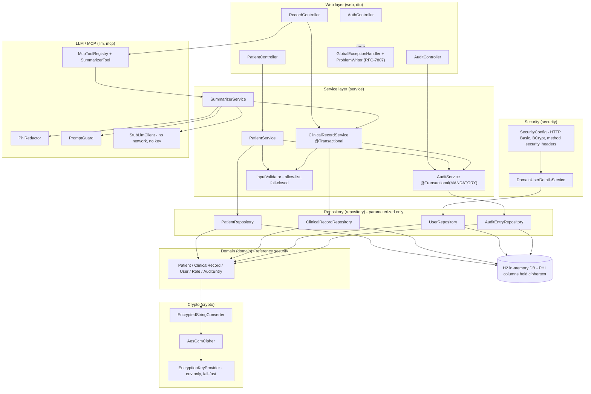

# VitalLedger — Architecture

VitalLedger is a layered Spring Boot service. Requests flow **web → service →
repository → database**, with three cross-cutting concerns wired in: **crypto**
(encryption at rest), **security** (authn/authz), and **llm/mcp** (the secure
summarizer). The layering is a security boundary, not just organization: validation and
RBAC gate the service tier, and no controller touches persistence directly.

## Layers and responsibilities

| Layer | Package | Responsibility |
|---|---|---|
| Web (API) | `web`, `dto` | Controllers, DTOs + bean validation, RFC-7807 no-leak error handling, auth entry points |
| Security | `security` | HTTP Basic + BCrypt, `@EnableMethodSecurity`, secure headers, user-details service |
| Service | `service` | Fail-closed validation, business rules, transactional create-with-audit, orchestration |
| LLM / MCP | `llm`, `mcp` | PHI redaction, prompt-injection guard, role-separated stub LLM client, MCP tool + registry |
| Repository | `repository` | Parameterized Spring Data JPA repositories (no string SQL) |
| Domain | `domain` | JPA entities with reference security (Patient, ClinicalRecord, User, Role, AuditEntry) |
| Crypto | `crypto` | AES-GCM cipher, JPA encrypting converter, environment-only key provider |
| Config | `config` | Startup seed data (demo users, BCrypt-hashed) |

## Component diagram

## Key design decisions

- **Encryption at rest via a JPA converter, not ad-hoc calls.** PHI fields are
  annotated `@Convert(converter = EncryptedStringConverter.class)`. Encryption happens
  transparently on write and read, so no service code can accidentally persist
  plaintext. The converter delegates to `AesGcmCipher`, which is injected through a
  one-time static bootstrap hook because JPA (not Spring) instantiates converters.
- **Environment-only key, fail-fast.** `EncryptionKeyProvider` reads
  `vitalledger.aes.key` (relaxed-bound from `VITALLEDGER_AES_KEY`). No default literal;
  a missing/invalid key stops startup. Key material never reaches a log or exception.
- **Transaction boundary owns the audit write.** `ClinicalRecordService.create` is
  `@Transactional`; `AuditService.record` is `@Transactional(propagation = MANDATORY)`,
  which forces the audit write to join the caller's transaction — no orphan records, no
  orphan audit rows.
- **Two-tier validation.** Controller bean validation is the first gate; the
  service-tier `InputValidator` is the authoritative fail-closed allow-list. Defense in
  depth, not redundancy.
- **Secure-by-construction data access.** Every repository uses Spring Data derived
  queries or bound-parameter JPQL. There is no string-built SQL anywhere.
- **Summarizer isolates the model behind redaction + guarding + role separation.** The
  default `LlmClient` is a local stub, so the reference app makes no outbound call and
  needs no API key; a real provider would read its key only from the environment.

## Tech stack

| Concern | Choice |
|---|---|
| Language | **Java 21** |
| Framework | **Spring Boot 3.3** — Spring MVC (REST) + Spring Security |
| Persistence | **Spring Data JPA** over **H2** in-memory (JDBC), `ddl-auto=create-drop` |
| Validation | Jakarta Bean Validation (`spring-boot-starter-validation`) |
| Crypto | **AES-GCM** (`AES/GCM/NoPadding`, 96-bit IV, 128-bit tag) for PHI at rest; **BCrypt** for passwords |
| AuthN / AuthZ | HTTP Basic; method-level `@PreAuthorize` (RBAC); stateless |
| LLM / MCP | **Stub LLM client** (no network, no key) behind an `LlmClient` interface; MCP-style tool (`name`/`description`/`inputSchema`, tools/list + tools/call) |
| Errors | RFC-7807 `application/problem+json`, stable codes + correlation id |
| Packaging | **Docker** (multi-stage Temurin 21 build, non-root runtime user); `docker-compose` with env-file secrets |
| Testing | JUnit 5 + Spring Security Test (`mvn clean test`) |

## Runtime and secrets posture

- **Stateless containers.** Multi-stage Dockerfile builds a boot jar and runs it as an
  unprivileged user (uid 10001). `VITALLEDGER_AES_KEY` must be provided at runtime
  (`--env-file .env` / compose `env_file`); it is never baked into the image.
- **H2 console off** (attack surface); `open-in-view=false`.
- **No-leak error properties** in `application.properties`
  (`server.error.include-stacktrace=never`, etc.) back the RFC-7807 handler.
- **Secrets hygiene.** `.gitignore` excludes `.env`, `*.pem`, `*.key`, `*.p12`, and
  credential patterns. Tests use a synthetic test key and synthetic PHI — no real key
  or PHI anywhere in the tree.
