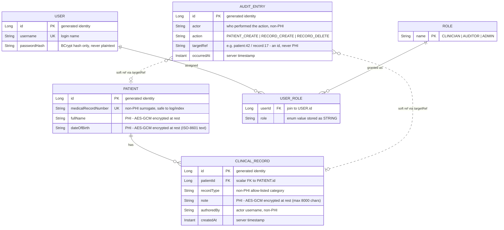

# VitalLedger — Entity-Relationship Design

This is the domain you will build. VitalLedger stores **PHI (protected health
information)**, so the ERD does more than name tables — it marks exactly which
fields are PHI and therefore **must be encrypted at rest**. Treat that column as a
hard requirement: any field flagged PHI below must be unreadable in a raw database
read.

## Domain overview

Four persisted entities plus a role enumeration:

- **Patient** — a person under care. Carries a non-PHI business key
  (`medicalRecordNumber`) plus two encrypted direct identifiers.
- **ClinicalRecord** — a clinical note attached to a patient. The free-text note is
  PHI; it holds the patient link as a plain foreign-key scalar, not a mutable object
  reference.
- **User** — an application user with a BCrypt password hash and a set of roles.
- **Role** — the RBAC role enumeration (`CLINICIAN`, `AUDITOR`, `ADMIN`).
- **AuditEntry** — an immutable audit-trail row. Deliberately contains **no PHI** —
  only who did what to which target, and when.

## ERD

Notes on the diagram:

- **Solid lines** are enforced relationships. `PATIENT ||--o{ CLINICAL_RECORD`: one
  patient has zero or more clinical records. `USER`/`ROLE` resolve through the
  `USER_ROLE` element-collection join (`user_roles` table); a user holds a set of
  roles, and roles are exposed only as an unmodifiable defensive copy.
- **Dashed lines** to `AUDIT_ENTRY` are *soft* references. An audit row records its
  target as a `targetRef` string (`record:17`), not a database foreign key, so the
  audit log stays independent and never carries a live object reference to PHI.

## Data dictionary

| Entity | Field | Type | PHI? | Encryption | Notes |
|---|---|---|:--:|---|---|
| Patient | id | Long (PK) | No | — | Generated identity |
| Patient | medicalRecordNumber | String (UK) | No | — | Non-PHI surrogate key; format `MRN-<4..10 digits>` |
| Patient | fullName | String | **Yes** | **AES-GCM at rest** | Direct identifier; max 120 chars |
| Patient | dateOfBirth | String | **Yes** | **AES-GCM at rest** | Direct identifier; ISO date `YYYY-MM-DD`, stored as ciphertext text |
| ClinicalRecord | id | Long (PK) | No | — | Generated identity |
| ClinicalRecord | patientId | Long (FK) | No | — | Scalar FK to `Patient.id` |
| ClinicalRecord | recordType | String | No | — | Allow-listed: `PROGRESS_NOTE`, `LAB_RESULT`, `PRESCRIPTION`, `DISCHARGE_SUMMARY`, `RADIOLOGY` |
| ClinicalRecord | note | String | **Yes** | **AES-GCM at rest** | Free-text clinical PHI; max 8000 chars |
| ClinicalRecord | authoredBy | String | No | — | Actor username |
| ClinicalRecord | createdAt | Instant | No | — | Server-set on construction |
| User | id | Long (PK) | No | — | Generated identity |
| User | username | String (UK) | No | — | Login name |
| User | passwordHash | String | No | — | **BCrypt hash only** — never plaintext |
| User | roles | Set&lt;Role&gt; | No | — | Defensive copy in/out; `user_roles` join table, enum stored as STRING |
| AuditEntry | id | Long (PK) | No | — | Generated identity |
| AuditEntry | actor | String | No | — | Who performed the action |
| AuditEntry | action | String | No | — | Action label |
| AuditEntry | targetRef | String | No | — | `patient:<id>` / `record:<id>` — an id, never PHI |
| AuditEntry | occurredAt | Instant | No | — | Server-set on construction |

**PHI inventory (fields that MUST be ciphertext at rest):**
`Patient.fullName`, `Patient.dateOfBirth`, `ClinicalRecord.note`. Nothing else in the
schema is PHI — `medicalRecordNumber`, `recordType`, and every audit field are
deliberately non-PHI so lookups, categorization, and the audit log stay safe to read.
